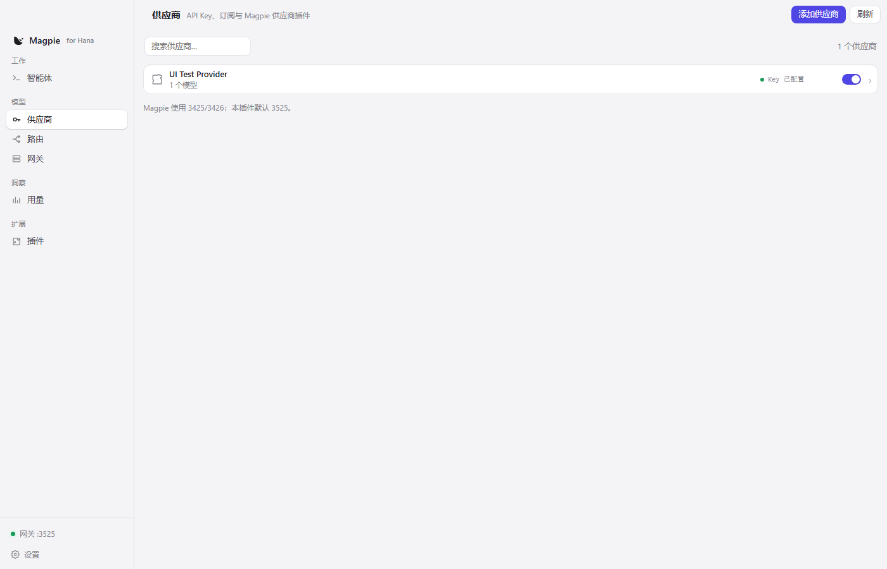

# Hana Magpie

[HanaAgent](https://github.com/liliMozi/openhanako) plugin that brings
[Magpie](https://github.com/yetone/magpie)'s model layer into HanaAgent:
provider plugins, sign-in, model discovery, a local gateway, routing groups,
failover and usage.

HanaAgent gets one provider (`hana-magpie`); you install one plugin. You do not
need to install Magpie, and Magpie does not need to run in the background.

> Hana Magpie is an independent port, not an official Magpie or HanaAgent
> project. See [NOTICE.md](NOTICE.md).



## Features

| Magpie feature | In Hana Magpie |
| --- | --- |
| Provider plugins (OpenCode v1 hook contract) | Yes - `config`, `auth`, `provider.models`, `loader.fetch`, `usage`, `refresh` |
| Plugin market, npm / GitHub / folder install | Yes - `@magpie-community/*` provider plugins work as-is |
| API key and OAuth sign-in | Yes - Magpie prompt / authorize / callback flow |
| Multiple accounts, failover | Yes - accounts rotate, then models, before the agent sees an error |
| Local gateway | Yes - Chat Completions, Responses, Anthropic Messages, Gemini |
| Routing groups | Yes - smart / round-robin / ordered |
| Usage, tokens, cost, quota windows | Yes - `auth.usage` is displayed and summed |
| Magpie-style UI | Yes - sidebar, provider rows, editor, market and dialogs in Chinese |

The gateway is loopback-only and listens on **127.0.0.1:3525** by default.
Magpie uses 3425/3426, so both can run at the same time. The port is
configurable; 3425 and 3426 are rejected.

## Install

HanaAgent 0.450.0 or newer is required.

1. Open **HanaAgent -> Settings -> Plugins**.
2. Enable **Allow full-access plugins** (full-access is needed for the local
   gateway and provider-plugin host).
3. Drag this folder or the release `hana-magpie.zip` into the plugin install
   area.
4. Open the **Magpie** tab.

On first start the plugin starts its gateway and registers the `hana-magpie`
provider in HanaAgent. No manual provider setup is required.

Marketplace submission is pending. Until it is accepted, use the release ZIP
from [Releases](https://github.com/miaoyongxu/hana-magpie/releases).

## Providers

The add-provider sheet follows Magpie's categories:

- **Subscriptions** - sign in to a plan; no API key
- **From plugins** - provider plugins installed through the market
- **Providers (API key)** - vendor APIs such as OpenAI, Anthropic, Gemini,
  DeepSeek, Kimi, GLM, Qwen, xAI, Groq, Mistral and Ollama
- **Relays** - one key for many vendors (OpenRouter, SiliconFlow, AiHubMix,
  302.AI, Vercel AI Gateway)

Provider details include accounts, per-model enable/disable, select-all /
invert, save, test and quota windows.

## Security and data

- Credentials stay under HanaAgent's plugin data directory
  (`plugin-data/hana-magpie/`), never in this repository.
- The gateway binds to loopback only.
- Provider plugins run in a child process; they receive Magpie's normal
  provider hooks and their own credentials.
- The plugin talks to HanaAgent through its local API and does not edit
  HanaAgent configuration files directly.

## Development

The plugin is plain ESM; no build step is required.

```text
hana-magpie/
  manifest.json        HanaAgent plugin manifest (manifestVersion 1)
  index.js             lifecycle entry
  lib/                 gateway, catalog, host client, installer, state
  routes/              HanaAgent HTTP routes
  tools/               agent-facing status tool
  assets/              Magpie UI assets and provider icons
  docs/                screenshots
```

Useful checks:

```bash
node --check index.js
node --check lib/server.js
```

To produce a release ZIP, include `manifest.json`, `index.js`, `lib/`,
`routes/`, `tools/`, `assets/`, `docs/`, README files, NOTICE and LICENSE at
the ZIP root.

## Attribution and license

- Magpie: MIT, <https://github.com/yetone/magpie>
- OpenCode plugin API: MIT
- HanaAgent: Apache-2.0, <https://github.com/liliMozi/openhanako>
- Magpie community provider plugins: each plugin's own MIT license

Hana Magpie is MIT licensed. See [LICENSE](LICENSE), [NOTICE.md](NOTICE.md)
and the vendored Magpie license at
[assets/LICENSE.magpie.txt](assets/LICENSE.magpie.txt).

Chinese documentation: [README.zh-CN.md](README.zh-CN.md).
