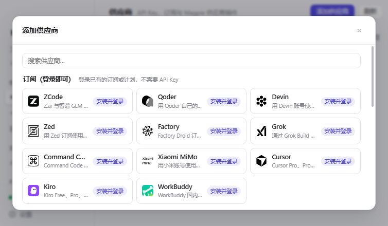
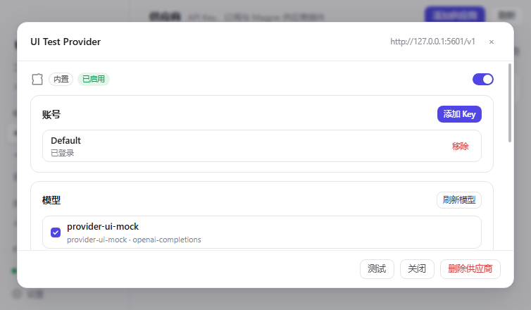

# Hana Magpie（花喜鹊）

把 [Magpie](https://github.com/yetone/magpie) 的模型层做成 **HanaAgent 插件**：
供应商插件、登录、模型发现、本地网关、故障切换、路由组与用量都在
HanaAgent 里运行，**不需要安装 Magpie，也不需要 Magpie 在后台运行**。

## 它能做什么

- **Magpie / OpenCode 供应商插件**：`config`、`auth`、`provider.models`、
  `loader.fetch`、`usage`、`refresh` 等钩子与 Magpie 一致；社区插件
  （`@magpie-community/*`）可直接安装。
- **插件市场 / npm / GitHub / 文件夹安装**：内置 Magpie 的插件市场列表。
- **跟随 HanaAgent 主题**：读取 HanaAgent 传入的 `hana-theme` / `hana-css`，
  深色、浅色和自定义主题使用同一套颜色变量。
- **卡片中心封面**：首次启动时把插件页面卡的默认花纹换成 Magpie 卡片封面；
  用户在卡片中心手动换过卡面后不会被覆盖。
- **供应商管理**：按“订阅 / 来自插件 / 供应商（API Key）/ 中转”添加；供应商列表支持搜索、启用/停用、重新排序；详情里管理账号、模型开关、保存、测试和额度。
- **登录**：API Key、OAuth（浏览器/设备码）、多账号、刷新 token。
- **本地网关**：Chat Completions、Responses、Anthropic Messages、Gemini
  原样转发；账号轮换、故障切换、路由组（智能 / 轮询 / 顺序）。
- **用量**：调用、token、费用、额度窗口（Magpie 的 `auth.usage`）。
- **像 Magpie 的界面**：同一套侧栏、列表、弹窗、插件市场与视觉语言，
  由 HanaAgent 的插件页面承载。

## 安装

1. HanaAgent → 设置 → 插件 → 打开 **允许全权插件**。
2. 把 `hana-magpie` 文件夹（或发布 zip）拖进插件安装区。
3. 打开顶部标签栏里的 **Magpie**。

首次启动会自动创建本地网关，并把 `hana-magpie` 供应商注册进 HanaAgent；
不需要在 HanaAgent 设置里手动添加供应商。之后在 **Magpie → Providers**
添加 API Key 或安装供应商插件，在 **Magpie → Agents** 给 Agent 选模型。

## 供应商

**添加供应商** 按 Magpie 的方式分为四类：

- **订阅（登录即可）**：已安装/可安装的订阅插件，登录即可，无需 API Key
- **来自插件**：由 Magpie 供应商插件提供的 API Key 型供应商
- **供应商（API Key）**：OpenAI、Anthropic、Gemini、DeepSeek、Kimi、智谱、Qwen、xAI、Groq、Mistral、Ollama 等厂商自己的 API
- **中转（一个密钥多家厂商）**：OpenRouter、SiliconFlow、AiHubMix、302.AI、Vercel AI Gateway

已安装的 Magpie 供应商插件会出现在前两组；未安装的订阅插件可直接点“安装”。

供应商列表支持搜索、启用/停用、显示正在使用它的智能体，以及状态标签。
点击任意一行打开供应商详情：

- **账号**：添加/移除 Key、停用账号、退出插件账号；插件账号可多开
- **模型**：全选、反选、逐个启用/停用、刷新模型
- **设置**：修改名称、Base URL、接口协议
- **额度**：读取 Magpie 供应商插件报告的套餐额度窗口
- **测试**：通过 HanaAgent 的模型健康检查实际发一次小请求
- **删除供应商**：插件供应商只删除该供应商，不卸载插件；删除后可在“添加供应商 → 来自插件”里恢复

## 端口

- 网关只监听 `127.0.0.1`，默认 **3525**。
- Magpie 使用 **3425 / 3426**；本插件刻意避开这两个端口，设置页也会拒绝。
- 端口可在 **Magpie → Settings** 修改；改端口后插件会自动把 HanaAgent 的
  供应商地址重新同步到新端口。

## 数据位置

`${HANA_HOME}/plugin-data/hana-magpie/`：

- `state.json`：设置、内置供应商、路由组、Agent 绑定
- `builtin-auth.json`：内置供应商 API Key（0600）
- `plugin-auth.json`：供应商插件登录信息（OpenCode/Magpie 的 auth 格式）
- `plugins/`：安装的 Magpie 供应商插件
- `usage.jsonl`：每次网关请求的用量
- `logs/hana-magpie.log`：日志

## 常见问题

- **页面只显示文字、没有样式，或一直停在“加载中”**：关闭 Magpie 标签再重新打开（HanaAgent 会为新的 iframe 生成新的资产会话）。插件页面使用 HanaAgent 注入的 `hana-asset-base` 加载 CSS/JS，不是独立静态服务器。
- **安装 zip 报 manifest 解析错误**：请使用本仓库重新打包后的 zip；早期版本的 `manifest.json` 带 UTF-8 BOM，HanaAgent 的严格 JSON 解析会拒绝。
- **Magpie 标签没有出现**：确认设置 → 插件里已启用 Hana Magpie，并打开“允许全权插件”；然后刷新 HanaAgent 窗口。
- **更新插件后供应商功能仍是旧版**：HanaAgent 的插件模块有 ESM 缓存，更新插件后重启一次 HanaAgent；页面资源本身会随 iframe 重新加载。
- **页面正常但没有模型**：Magpie 的供应商体系是独立的一层，需要先在 **供应商** 添加 API Key 或安装供应商插件；HanaAgent 原有的供应商不会自动出现在 Magpie 中。

## 与 Magpie 的关系

这是一个**移植**，不是 Magpie 官方项目：

- `lib/host.vendor.mjs` 直接来自 Magpie 的 `internal/plugin/host.js`（MIT），
  只改了 Bun 相关的 3 处，让它在 Node/HanaAgent 里运行。
- `lib/host-client.js` 用 Node 重新实现了 Magpie Go 侧与插件宿主之间的
  JSON 行协议。
- 市场数据、CSS、图标、供应商预设、网关行为与界面语言来自 Magpie。
- 没有复制 HanaAgent 源码；只使用它公开的插件 API 与本地 HTTP API。

完整清单与许可证见 [NOTICE.md](NOTICE.md)。本项目自身为 MIT。

## 限制

- 只做 Magpie 的**供应商插件**能力；Magpie 的网关中间件、MCP 工具页、
  其他 Agent 的配置文件、CLI/TUI/菜单栏应用没有移植。
- 供应商插件以你的用户权限运行；只安装你信任的插件。
- 依赖 Bun 专有 API 或原生 Node 插件的供应商插件可能无法运行。
- 内置供应商的外部请求走 HanaAgent 进程；插件宿主的请求走独立 Node 子进程。
